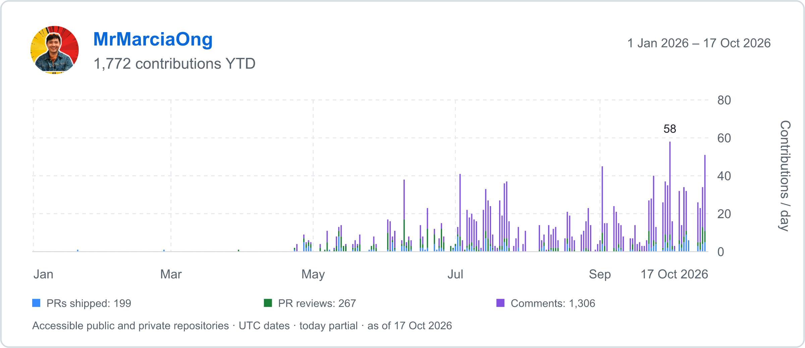
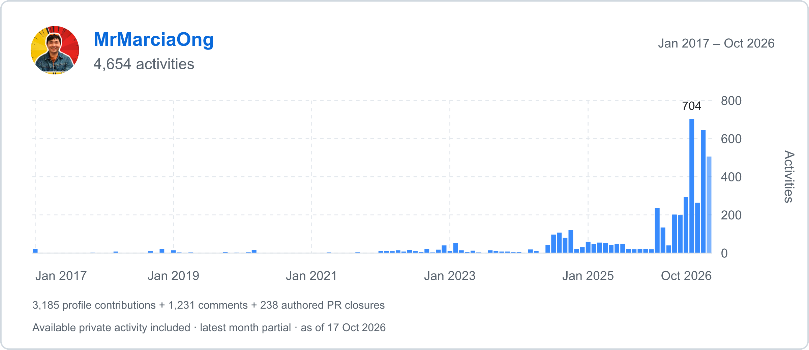
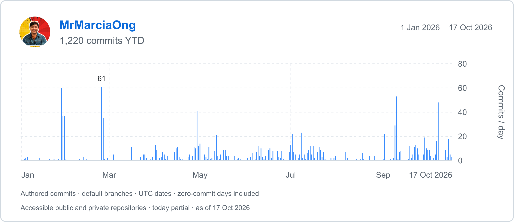

# GitHub contribution chart

Generate daily year-to-date contribution and commit charts, plus monthly activity, for any GitHub account. Export each chart as a PNG, an SVG, interactive HTML, and a CSV.







## Generate your chart

Install [GitHub CLI](https://cli.github.com/) and [uv](https://docs.astral.sh/uv/), then run:

```sh
gh auth login
gh repo clone MrMarciaOng/github-contribution-chart
cd github-contribution-chart
uv run generate_chart.py --refresh
```

The generator uses your active GitHub CLI account. `uv` installs Python and the pinned rendering dependency as needed.

To generate a chart for another account, replace `USERNAME` with its GitHub login:

```sh
uv run generate_chart.py --username USERNAME --refresh
```

To limit the chart to activity since a particular year, add `--from-year`:

```sh
uv run generate_chart.py --from-year 2023 --refresh
```

Open `output/github-contributions-ytd.png` for daily contributions, `output/github-commits-ytd.png` for daily commits, or `output/github-activity.png` for monthly activity. Each chart also has an `.html` export with values on hover or tap, an `.svg`, and a `.csv`.

`--from-year` limits the monthly chart. Both daily charts start on January 1 of the current UTC year and end at the snapshot time. They include days with zero activity and mark today as partial.

To regenerate the chart from cached data, omit `--refresh`:

```sh
uv run generate_chart.py
```

## Read the totals

### Daily year-to-date contributions

This chart focuses on collaboration, with three categories:

- PRs shipped: PRs authored by the target account, counted when merged. Closing a PR without merging it does not count as shipping.
- PR reviews: each submitted review, including approvals, requested changes, and comment-only reviews. Draft reviews are excluded. A review that was later dismissed still counts on its submission date.
- Comments: issue and PR conversations, direct commit comments, discussion replies, and inline review comments authored by the target account. Review-body text counts as part of the review. Individual inline comments count separately.

The chart excludes commits and uses no profile contribution baseline. Each review or comment ID counts once, and each authored PR counts once when shipped. Events use UTC submission, publication, or merge dates. The CSV contains `date`, `count`, `prs_shipped`, `reviews`, and `comments` columns.

Review discovery uses GitHub's [reviewed-by search](https://docs.github.com/en/search-github/searching-on-github/searching-issues-and-pull-requests#search-by-pull-request-review-status-and-reviewer), then paginates the account's reviews and their comments. The counts include public and private work visible to the authenticated account. Deleted, inaccessible, or unindexed objects are outside this chart. This is a custom contribution count and can differ from GitHub's profile calendar.

### Daily year-to-date commits

The daily chart counts commits authored by the target account, including merge commits. It groups author timestamps into UTC dates and counts each commit SHA once across repositories.

The source is [GitHub commit search](https://docs.github.com/en/search-github/searching-on-github/searching-commits), which searches default branches. Results include public and private repositories visible to the authenticated account. Commits on other branches, inaccessible repositories, or commits GitHub has not indexed are outside this chart. These counts can differ from profile contribution totals.

The generator paginates results and splits date ranges to avoid GitHub's 1,000-result search limit. When the search rate limit is reached, it retries twice with waits of up to 60 seconds. It fails if it cannot retrieve a complete search result. The daily CSV contains `date` and `count` columns.

### Monthly activity

The chart combines these counts for each month, starting with the account's creation year:

- GitHub profile contributions, including commits, opened pull requests, reviews, and other activity that GitHub counts on a profile.
- Issue and PR conversation comments, plus direct commit comments, counted on their creation dates in UTC.
- PRs authored by the target account that are currently closed or merged, counted on their latest closure dates in UTC. A merged PR counts as one closure.

The current month is partial. A PR can contribute once when opened and once when closed. These represent separate activities. The combined total is a custom activity count.

The CSV includes `count`, `profile_contributions`, `comments`, and `prs_closed` columns. The HTML chart shows the monthly breakdown on hover or tap.

Profile counts follow [GitHub's contribution criteria](https://docs.github.com/en/account-and-profile/reference/profile-contributions-reference). Inline review comments, discussion comments, deleted comments, and earlier close/reopen cycles are outside the extra comment and closure counts. Review submissions already contribute to the profile count.

Private profile activity appears when GitHub exposes its aggregate counts. Extra comments and closures include only objects visible to the authenticated account, so access restrictions can leave gaps. The generator paginates through the historical connections. It does not use the recent-events feed.

The exports contain daily or monthly counts, with no private repository names, comment text, or PR contents.

The files in `output/` show an example for `MrMarciaOng`. Generate your own chart to replace them. Raw daily data, activity IDs and timestamps, and downloaded avatars stay in the local cache and are ignored by Git.

## Run checks

```sh
python3 -m unittest -v
```

## License

[MIT](LICENSE)
